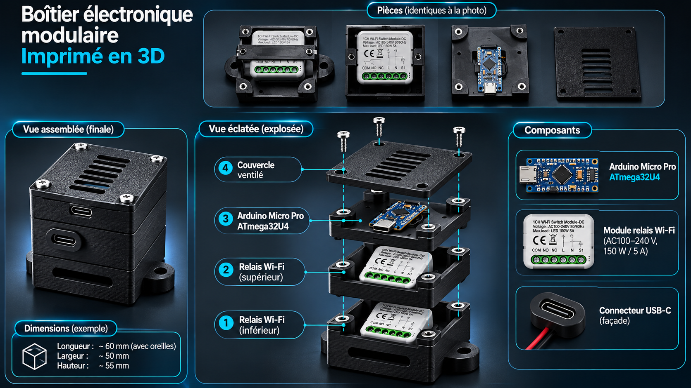
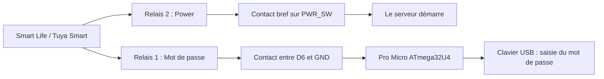
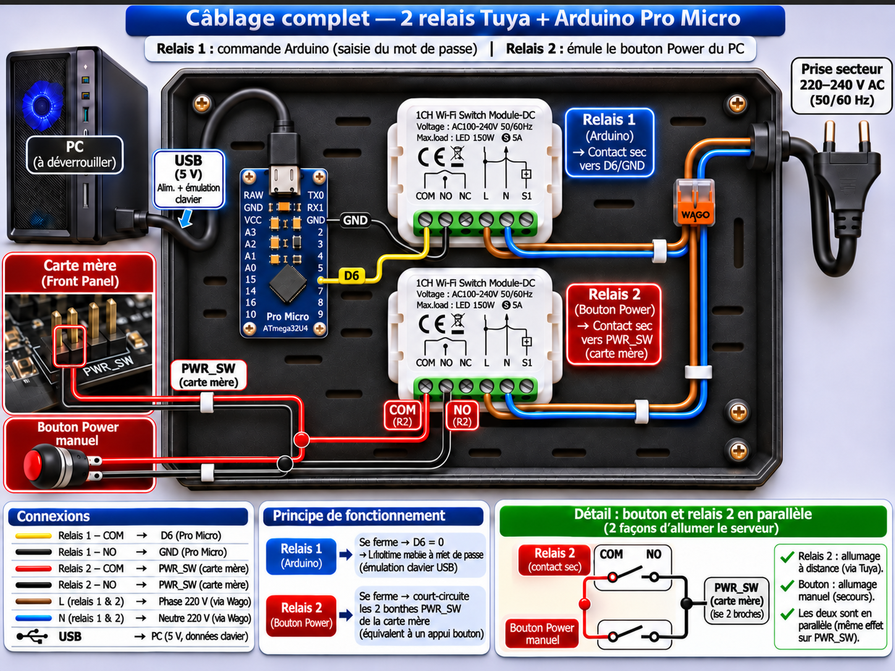
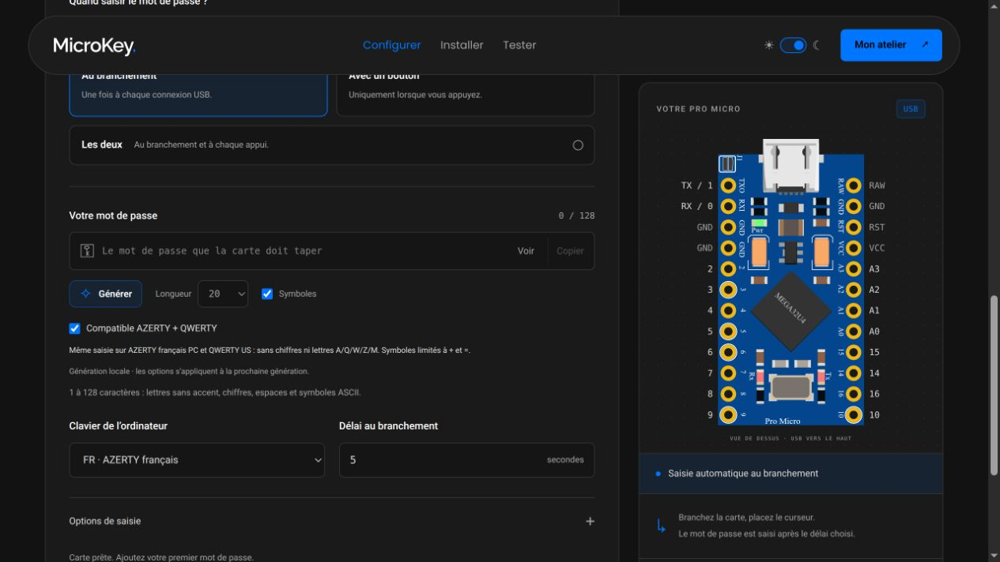
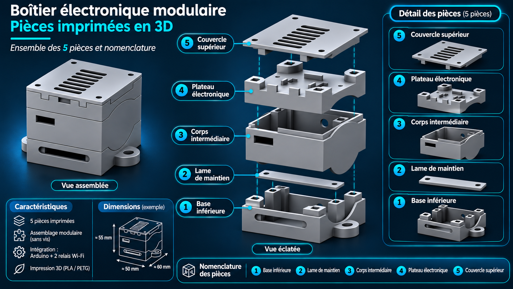

# Pro Micro + Tuya — démarrer son serveur à distance

**Allumer un serveur, attendre son écran de connexion, puis lui faire taper son mot de passe depuis Smart Life ou Tuya Smart.**

Le projet associe deux relais Wi-Fi et un **Arduino Pro Micro ATmega32U4**. Un relais remplace un appui sur le bouton Power ; l’autre demande au Pro Micro de saisir le mot de passe comme un clavier USB. Une petite **web app Python locale** permet de flasher la carte, d’enregistrer le mot de passe et de choisir la broche de déclenchement.



## Le fonctionnement, simplement

1. Dans **Smart Life / Tuya Smart**, déclencher le relais **Power**.
2. Le serveur démarre, comme après un appui sur son bouton physique.
3. Attendre que l’écran de connexion soit prêt et que le champ du mot de passe soit actif.
4. Déclencher le relais **Mot de passe**.
5. Le Pro Micro tape le mot de passe enregistré, puis éventuellement **Entrée**.



**Les deux applications ont des rôles différents :**

| Application | Son rôle | Quand l’utiliser |
| --- | --- | --- |
| **Web app Python** de ce dépôt | Flasher le Pro Micro et configurer son mot de passe, son clavier et son GPIO | À l’installation et pour changer les réglages |
| **Smart Life / Tuya Smart** sur le téléphone | Commander les deux relais Wi-Fi | Pour démarrer le serveur et déclencher la saisie à distance |

Une fois configuré, le Pro Micro fonctionne **sans laisser la web app ouverte**. Le code Python ne se connecte pas à l’API Tuya et ne demande aucun identifiant Tuya. La commande à distance passe par les relais associés à l’application mobile.

## Matériel nécessaire

| Matériel | Quantité | Utilité |
| --- | --- | --- |
| Pro Micro **ATmega32U4** | 1 | Se présente au serveur comme un clavier USB |
| Relais Wi-Fi compatibles Smart Life / Tuya, à **contact sec isolé COM/NO** | 2 | Commander Power et la saisie du mot de passe |
| Câble USB **de données** adapté au Pro Micro | 1 | Alimenter la carte et transmettre les frappes |
| Serveur ou PC avec connecteur **PWR_SW** accessible | 1 | Machine à démarrer |
| Fils et connecteurs adaptés | Selon le montage | Relier les contacts de commande |
| Boîtier et supports imprimés en 3D | Selon les fichiers | Maintenir les éléments du montage |
| Bouton Power manuel | Facultatif | Conserver une commande locale en parallèle |

La web app gère les Pro Micro **5 V / 16 MHz** et **3,3 V / 8 MHz**. Choisir la variante réellement inscrite sur la carte. Un Nano classique ATmega328P ou un Pro Micro RP2040 ne convient pas à ce firmware.

## Câblage des commandes



**Ce visuel est une illustration de principe.** Les positions des borniers et les indications dessinées doivent être vérifiées sur la notice du matériel réel. Le dessin contient une alimentation secteur : ce README décrit uniquement les **contacts de commande isolés**, pas un guide de raccordement du 230 V. Faire réaliser ou vérifier cette partie par une personne qualifiée. Ne jamais amener de tension secteur sur le Pro Micro, l’USB ou la carte mère.

Utiliser de vrais **contacts secs isolés**, sans tension injectée sur COM/NO. Tous les modules Tuya ne fournissent pas ce type de sortie : le vérifier dans la documentation du modèle avant de le relier au PC.

### Relais 1 : demander la saisie du mot de passe

L’exemple des images utilise **D6**. Il faut donc sélectionner **D6 dans la web app** ; le choix initial de l’application est D4.

| Borne de contact du relais 1 | Broche du Pro Micro |
| --- | --- |
| **COM** | **D6**, ou le GPIO choisi dans la web app |
| **NO**, normalement ouvert | **GND** |
| **NC**, normalement fermé | Non utilisé |

```text
Pro Micro D6 ─── COM [relais 1] NO ─── GND du Pro Micro
```

Quand le relais ferme ce contact, la broche passe à l’état bas et le Pro Micro tape le mot de passe **une seule fois**. Il faut rouvrir le contact avant de pouvoir déclencher une nouvelle saisie. La résistance de rappel interne est activée par le firmware : aucune résistance externe n’est nécessaire pour ce contact sec.

Le Pro Micro reste relié en USB au serveur. Ses broches disponibles pour le déclenchement sont **D0 à D10, D14 à D16 et A0 à A3**. RAW, VCC, GND et RST ne sont pas des entrées de déclenchement à sélectionner.

### Relais 2 : démarrer le serveur

Les contacts **COM** et **NO** du relais 2 se raccordent aux **deux broches PWR_SW** de la carte mère, identifiées dans **la notice de cette carte mère**. Le relais simule un appui bref sur le bouton Power. Ne pas confondre ces broches avec RESET, les LED ou une alimentation.

Le bouton Power manuel peut rester **en parallèle** sur les mêmes deux broches. Le serveur peut ainsi être démarré localement ou depuis le téléphone.

Faire les raccordements hors tension. Ne pas relier le GND du Pro Micro au connecteur Power : les deux commandes passent chacune par leur propre contact sec isolé.

## Installer et lancer la web app

Prérequis : **Linux ou macOS**, Python **3.10 ou plus récent** avec `venv`, `make`, un accès Internet pour la première installation et un câble USB de données. L’installation automatique des outils Arduino prend en charge Linux/macOS en x86-64 ou ARM64.

```sh
git clone https://github.com/Chrisnox-209/pro-micro-tuya-server.git
cd pro-micro-tuya-server
make run
```

Ouvrir **[http://127.0.0.1:5000](http://127.0.0.1:5000)** dans le navigateur. Le premier lancement crée l’environnement Python et installe les dépendances. Le serveur tourne ensuite en arrière-plan, uniquement sur cet ordinateur.

| Commande | Résultat |
| --- | --- |
| `make run` | Lancer la web app |
| `make stop` | L’arrêter |
| `make status` | Vérifier si elle tourne |
| `make tools` | Installer les outils Arduino et les définitions de cartes |
| `make test` | Exécuter les tests, sans flasher la carte |

Pour changer de port : `make stop`, puis `make run PORT=5050`. Ouvrir alors `http://127.0.0.1:5050`.

## Configurer le Pro Micro

### 1. Installer son firmware

1. Brancher le Pro Micro à l’ordinateur qui exécute la web app.
2. Vérifier le port USB détecté.
3. Ouvrir **Installer** et cliquer sur **Installer les outils** si nécessaire.
4. Choisir **5 V / 16 MHz** ou **3,3 V / 8 MHz**, selon la carte physique.
5. Cliquer sur **Flasher le firmware** et attendre la confirmation.

Le flash remplace le programme de la carte. Il ne contient aucun mot de passe par défaut ; un mot de passe déjà enregistré par cette application est conservé.

### 2. Choisir le déclenchement par relais

Dans **Configurer** :

1. Sélectionner **Avec un bouton**. Un relais à contact sec agit exactement comme ce bouton.
2. Choisir **D6** pour reproduire le montage présenté, ou une autre entrée disponible.
3. Vérifier la broche sur le dessin interactif : elle s’illumine en bleu.
4. Saisir le mot de passe à taper, ou utiliser **Générer**.
5. Choisir la disposition du clavier de la machine cible.
6. Dans **Options de saisie**, activer **Ajouter Entrée** seulement si une validation automatique est souhaitée.
7. Cliquer sur **Enregistrer sur la carte**.
8. Débrancher puis rebrancher le Pro Micro pour activer les réglages.



| Mode de déclenchement | Ce que fait la carte |
| --- | --- |
| **Au branchement** | Tape une fois après le délai USB choisi |
| **Avec un bouton** | Attend la fermeture du contact entre le GPIO et GND — mode conseillé pour ce montage à relais |
| **Les deux** | Tape au branchement, puis à chaque nouvelle fermeture du contact |

Le délai au branchement ne retarde pas le déclenchement par GPIO. En mode relais, attendre que le serveur soit prêt **avant** de fermer le contact.

### 3. Générer ou copier un mot de passe

- **Générer** crée localement un mot de passe de **8 à 128 caractères**, avec 20 par défaut.
- **Compatible AZERTY + QWERTY**, coché par défaut, conserve seulement les caractères saisis à l’identique sur AZERTY français classique PC et QWERTY US. Ce mode exclut les chiffres et les lettres A/Q/W/Z/M, minuscules et majuscules. Avec **Symboles**, seuls `+` et `=` sont ajoutés.
- En décochant cette compatibilité, les chiffres et d’autres symboles sont disponibles. Le clavier configuré doit alors correspondre à celui du serveur.
- **Voir** affiche ou masque le contenu du champ ; **Copier** le place dans le presse-papiers.

Les cases du générateur s’appliquent au **prochain clic sur Générer**. Générer ou copier n’enregistre rien sur la carte : il faut ensuite cliquer sur **Enregistrer sur la carte**. Un mot de passe existant sur le serveur doit correspondre à celui enregistré dans le Pro Micro ; l’application ne change pas le mot de passe du compte du serveur.

### 4. Tester avant de l’utiliser sur le serveur

1. Ouvrir **Tester**, débrancher la carte, puis placer le curseur dans le champ de test masqué.
2. Rebrancher la carte.
3. En mode **Avec un bouton**, déclencher le relais 1 ou fermer brièvement le contact de commande entre le GPIO choisi et GND.
4. Vérifier la saisie reçue avant d’utiliser le montage sur le véritable écran de connexion.

Ne pas cliquer sur **Connecter** après ce rebranchement avant le test : une session de configuration désactive les déclenchements jusqu’au prochain redémarrage de la carte.

## Régler Smart Life / Tuya Smart

### Associer et nommer les relais

Associer les deux modules selon leur notice dans **Smart Life** ou **Tuya Smart**. Les nommer clairement, par exemple :

- **Serveur — Power** : relais 2 relié à PWR_SW.
- **Serveur — Mot de passe** : relais 1 relié au GPIO du Pro Micro.

Configurer une **impulsion brève avec retour automatique à OFF** lorsque le modèle le permet. Cette fonction peut s’appeler *inching*, *pulse*, *jog* ou mode impulsionnel. Une impulsion d’environ **0,5 seconde**, si le module et la carte mère l’acceptent, est un point de départ à tester ; la durée disponible dépend du matériel. Éviter un appui long sur Power, qui peut forcer l’arrêt de la machine.

L’état de repos des contacts doit être **ouvert**. Pour le relais Mot de passe, une fermeture maintenue ne produit pas de répétition : rouvrir le contact avant la demande suivante. Privilégier le retour à OFF géré par le module plutôt qu’une seconde commande réseau indispensable pour le libérer.

### Utilisation recommandée : deux commandes séparées

1. Déclencher **Serveur — Power** lorsque le serveur est éteint.
2. Attendre la fin du démarrage et la disponibilité du champ de mot de passe.
3. Déclencher **Serveur — Mot de passe**.

La commande Power simule un bouton : elle ne connaît pas l’état du serveur et ne garantit pas « allumer uniquement ». Ne pas la renvoyer sur une machine déjà allumée sans connaître son comportement.

### Facultatif : une scène « Démarrer mon serveur »

Si les modules et l’application proposent les scènes **Tap-to-Run / Exécuter**, créer une séquence :

1. Activer l’impulsion du relais Power.
2. Ajouter un délai correspondant au temps réel de démarrage du serveur.
3. Activer l’impulsion du relais Mot de passe.

Le délai de cette scène est réglé dans **Smart Life / Tuya**, pas dans la web app Python. La scène ne détecte pas l’écran de connexion : un démarrage plus lent peut faire taper le mot de passe trop tôt. Tester d’abord avec les deux commandes séparées. La disponibilité des scènes et des impulsions dépend du modèle ; voir les explications Tuya sur le [mode inching](https://support.tuya.com/en/help/_detail/K9hriniay8wfs) et les [actions avec délai](https://support.tuya.com/en/help/_detail/K9hutfnqcnby1).

## Boîtier et impression 3D



Le boîtier regroupe les relais et le Pro Micro. Les visuels présentent les supports, les passages de câbles et le couvercle. Leurs dimensions sont **illustratives** : les fichiers 3D définitifs feront foi pour les cotes et l’assemblage.

Le dossier **[`impression_3d/`](impression_3d/)** est prêt pour les futurs fichiers **STL, 3MF, STEP** et leurs sources de conception. Aucun modèle 3D n’est fourni pour le moment. Son [README](impression_3d/README.md) explique où les déposer et quelles informations joindre.

Le boîtier imprimé ne constitue pas, à lui seul, une protection électrique certifiée pour des éléments alimentés sur secteur. Adapter l’isolation, la séparation des circuits et la protection mécanique au matériel utilisé.

## Modifier les réglages plus tard

Rebrancher la carte à l’ordinateur de configuration, lancer `make run`, puis cliquer sur **Connecter**. Il est possible de modifier le GPIO, le mode ou les délais **en laissant le champ du mot de passe vide** pour garder le secret existant. Enregistrer, puis débrancher/rebrancher la carte.

**Effacer le mot de passe de la carte** supprime le secret du Pro Micro ; cela ne change pas le mot de passe du serveur. Après installation du firmware actuel, modifier les réglages ne nécessite pas de nouveau flash.

## Dépannage rapide

| Problème | Vérification |
| --- | --- |
| La carte n’apparaît pas | Utiliser un câble USB de données, actualiser les ports et vérifier les droits d’accès série |
| Le relais clique mais rien n’est tapé | Sélectionner **Avec un bouton**, vérifier le même GPIO dans le câblage et la web app, puis débrancher/rebrancher la carte |
| Une seule saisie puis plus rien | Le contact doit revenir à l’état ouvert entre deux demandes |
| Mauvais caractères | Vérifier le clavier cible, Verr. Maj. et la case de compatibilité utilisée lors de la génération |
| Le mot de passe est saisi trop tôt | Attendre avant de commander le relais Mot de passe, ou augmenter le délai de la scène Tuya |
| Aucun texte dans le bon champ | Le Pro Micro tape là où se trouve le curseur ; il ne sélectionne pas lui-même un champ de connexion |
| Le serveur ne démarre pas | Vérifier les bonnes broches PWR_SW dans la notice de la carte mère et le contact sec du relais 2 |
| Le port USB disparaît après un flash | Vérifier la variante 8/16 MHz et utiliser la récupération RESET |

### Récupération RESET

1. Dans **Installer**, sélectionner la bonne variante physique.
2. Ouvrir **Carte non détectée après un flash ?** et lancer **Récupérer via RESET**.
3. Attendre le message **Récupération prête**.
4. Faire deux contacts rapides entre **RST et GND**, puis les séparer complètement pendant le flash.

Le bouton **Afficher le repère RESET** illumine RST et GND en orange sur le dessin. Si le port reste figé, débrancher puis rebrancher l’USB avant une nouvelle récupération.

```sh
make recover BOARD=5v16
# Seulement pour une carte physique 3,3 V / 8 MHz :
make recover BOARD=3v8
```

Pour les droits USB sous Linux, les détails du protocole et les vérifications avancées, voir le **[guide technique](docs/guide-technique.md)**.

## Ce que le projet fait — et ses limites

- Le Pro Micro **émule un clavier USB** : il saisit le mot de passe à l’endroit où le clavier est attendu. Le fonctionnement sur un écran de connexion ou de déchiffrement au démarrage doit être testé sur le serveur concerné.
- Il n’affiche pas l’écran du serveur, ne déplace pas le curseur et ne remplace pas un accès KVM ou un outil d’administration à distance.
- La web app écoute uniquement sur **127.0.0.1**. Elle sert à la configuration locale ; ne pas l’exposer sur Internet pour commander le montage.
- Le mot de passe est stocké **en clair dans la mémoire du Pro Micro** afin de pouvoir être tapé. Toute personne ayant accès à la carte ou à la commande de saisie peut provoquer sa saisie : protéger le boîtier et l’accès Smart Life/Tuya.
- Aucun mot de passe utilisateur n’est inclus dans les sources ou le firmware compilé. La lecture de l’état de la carte renvoie les paramètres et la longueur du secret, jamais son contenu.

## Organisation du dépôt

```text
.
├── app.py                     # Web app Flask locale
├── device.py                  # Configuration USB et outils de flash
├── Makefile                   # make run, stop, tools, recover, test
├── requirements.txt           # Dépendances Python
├── firmware/promicro_key/     # Firmware ATmega32U4
├── templates/                 # Interface HTML
├── static/                    # Styles, scripts, polices et SVG interactif
├── scripts/                   # Lancement, outils Arduino et récupération
├── tests/                     # Tests Python, C++ et JavaScript
├── images/                    # Câblage, impression 3D et assemblage
├── impression_3d/             # Emplacement des futurs fichiers 3D
└── docs/                      # Guide technique et captures de la web app
```

## Tests

```sh
make test
```

Les tests couvrent le protocole USB, la validation des réglages, les routes locales, la récupération et le firmware simulé. Avec **g++**, ils vérifient notamment les modes USB/GPIO, l’anti-rebond et la mémoire EEPROM. Avec **Node.js**, ils vérifient aussi le générateur et l’identité des frappes sur les tables AZERTY/QWERTY. Ils ne flashent pas de carte et ne commandent pas les relais.

## Références

- [Guide technique du projet](docs/guide-technique.md)
- [Arduino CLI](https://docs.arduino.cc/arduino-cli/)
- [Bibliothèque Arduino Keyboard](https://github.com/arduino-libraries/Keyboard)
- [Définitions de cartes SparkFun](https://github.com/sparkfun/Arduino_Boards)
- [Tuya : fonctionnement du mode impulsionnel](https://support.tuya.com/en/help/_detail/K9hriniay8wfs)
- [Tuya : scènes Tap-to-Run et délais](https://support.tuya.com/en/help/_detail/K9hutfnqcnby1)

Interface visuelle inspirée de [Spotlight](https://bootstrapmade.com/demo/Spotlight/), avec accent bleu et mode clair/sombre. Les polices locales sont accompagnées de leurs licences dans `static/fonts/`.
