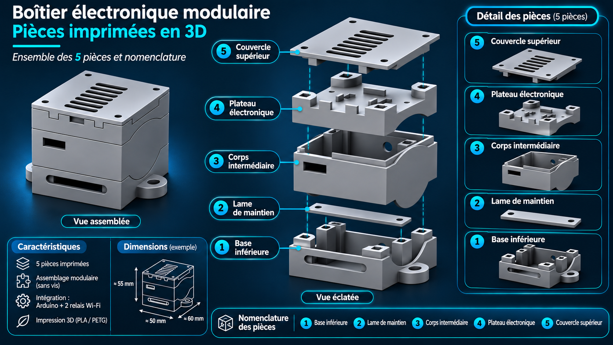

# Fichiers d’impression 3D

Ce dossier est prêt à recevoir les fichiers du boîtier du projet **MicroKey**. Aucun modèle 3D n’est encore fourni.



## Où déposer les fichiers

Les fichiers peuvent être ajoutés directement ici, ou rangés dans les sous-dossiers suivants à leur arrivée :

```text
impression_3d/
├── README.md
├── stl/          # Pièces exportées pour l’impression
├── 3mf/          # Projets d’impression
└── sources/      # STEP, FreeCAD, OpenSCAD ou autres sources de conception
```

Formats possibles : `.stl`, `.3mf`, `.step`, `.stp`, `.FCStd`, `.scad` ou le format du logiciel utilisé. Ne publier de G-code que si l’imprimante et le profil correspondants sont clairement précisés ; un fichier préparé pour une machine ne convient pas forcément à une autre.

## Informations à joindre aux modèles

- Nom et rôle de chaque pièce : base, support de relais, plateau Pro Micro, couvercle, etc.
- Dimensions réelles et référence des modules compatibles.
- Matériau, orientation d’impression et supports nécessaires.
- Hauteur de couche, remplissage et tolérances testés.
- Visserie ou méthode d’assemblage prévue.
- Numéro de version si une pièce est modifiée.

Les images du projet sont des illustrations : leurs cotes indicatives et leurs vues ne remplacent pas des fichiers de conception vérifiés. Adapter le boîtier aux composants réels, aux passages de câbles et aux exigences d’isolation de leurs alimentations. Un boîtier imprimé n’est pas automatiquement une enveloppe électrique certifiée.

## Ajouter les modèles au dépôt

Depuis la racine du projet, une fois les fichiers copiés :

```sh
git add impression_3d/
gcadd impression_3d "ajoute les fichiers du boîtier"
git push
```

`gcadd` est un helper personnel présenté par `gchelp`. Sans ces helpers, utiliser :

```sh
git commit -m "➕ add(impression_3d): ajoute les fichiers du boîtier"
```

Le dossier est suivi par Git grâce à ce README ; les futurs modèles peuvent donc être ajoutés et poussés normalement.
